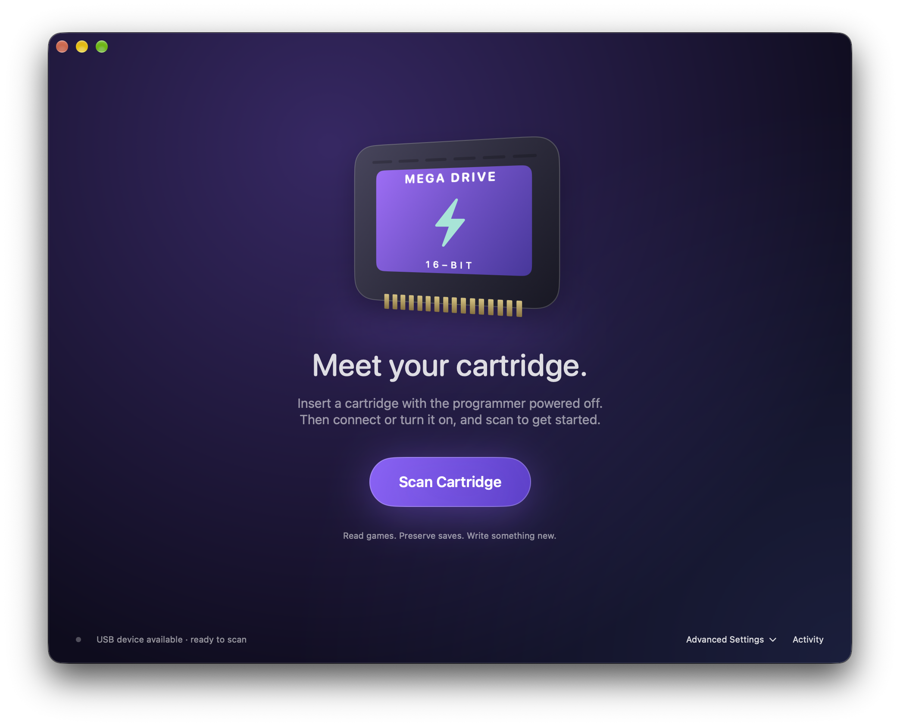
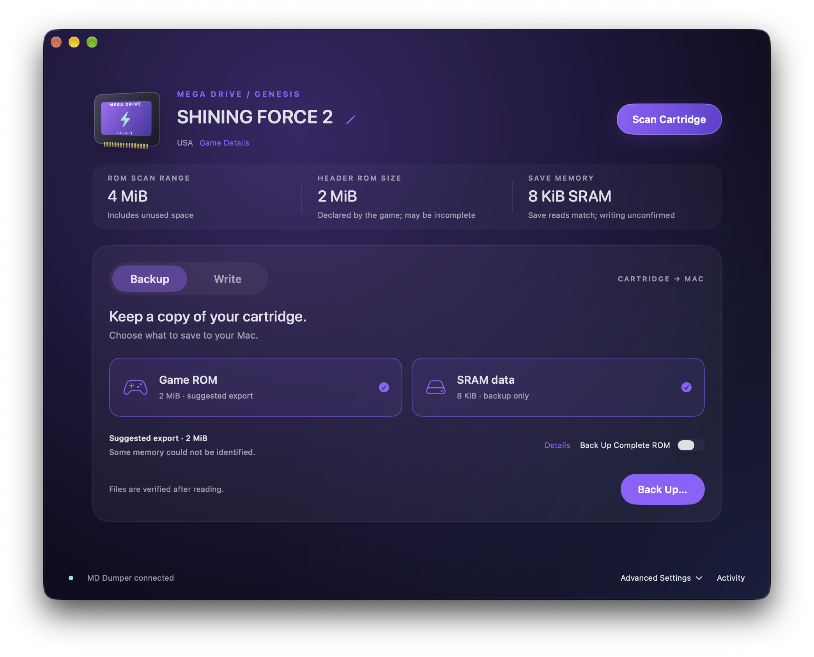

# FlashMD

Back up your Sega Mega Drive / Genesis games and saves, or write a new game to a compatible flash cartridge. FlashMD is a native macOS app for **FlashKit** and **MD Dumper** USB programmers.

[Visit the FlashMD website](https://www.digitalmints.com/flashmd/) for an overview, downloads and ways to support the project.

Insert a cartridge, click **Scan Cartridge**, then choose **Backup** or **Write**. FlashMD reads the game information, suggests a ROM backup size and checks the available save memory.



## Download and install

[Download the latest FlashMD release](https://github.com/mintho/FlashMD/releases/latest). The app is signed with an Apple Developer ID certificate and notarized by Apple. It runs on both Apple Silicon and Intel Macs with macOS 14 or later.

1. Download the ZIP file from the release's **Assets** section.
2. Open the ZIP and drag **FlashMD.app** into **Applications**.
3. Open FlashMD, connect your programmer and scan the cartridge.

When updating, quit FlashMD before replacing the app in Applications.

## What you need

- **macOS 14 Sonoma or later.**
- One of these USB programmers:
  - [Krikzz FlashKit programmer MD](https://krikzz.com/our-products/accessories/flashkitmd.html)
  - [MD Dumper by X-death on Tindie](https://www.tindie.com/products/xdeath/usb-megadrive-genesis-cartridge-readerwriter/)
- A Mega Drive / Genesis cartridge. ROM writing requires a compatible writable flash cartridge.

FlashMD communicates directly with the programmer. You do not need Python or the manufacturer's application to use it.

## Features

- Back up the game ROM, cartridge saves, or both.
- Write ROM files and restore SRAM saves on compatible cartridges.
- See the title, region, revision code and other game information. Use the pencil beside the title to correct a missing or misleading name.
- Get a suggested backup size based on the game header and cartridge contents.
- Back up SSF2-style banked games with MD Dumper, and Pier Solar with either programmer.
- Follow transfer progress, check the result and review previous actions in Activity.



## Before inserting or removing a cartridge

**Always remove power before inserting or removing a cartridge.** If a scan or transfer is running, wait for it to finish first.

- **MD Dumper:** turn it **off**.
- **FlashKit:** **unplug its USB cable**.

This applies every time, including the first insertion, removal after use and cartridge swaps. Closing FlashMD does not turn the programmer off.

After inserting a cartridge, reconnect USB or turn the programmer on, then scan it. Keep the cartridge and USB cable connected while scanning, backing up or writing.

## Back up a game or save

1. Insert the cartridge with the programmer off or unplugged, then connect or turn it on.
2. Open FlashMD and click **Scan Cartridge**. Close any other application using the programmer.
3. In **Backup**, select **Game ROM**, **SRAM data**, or both. Click anywhere on either panel to select it. Pier Solar saves appear as **SPI save data**.
4. Leave the suggested ROM size selected, or turn on **Back Up Complete ROM** to include the full range the reader can access. **Details** explains the size suggestion.
5. Click **Back Up…** and choose where to save it. FlashMD creates a new folder for each backup.
6. When finished, click **Show in Finder** to see the files, or **New Transfer** to return to the controls.

Backup verification is on by default: FlashMD reads the data again and compares it with the backup. Verification is always used for banked ROMs, SPI saves and MD Dumper streaming.

If save backup is unavailable, check **SAVE MEMORY** and **Game Details**. A missing or incorrect SRAM header can sometimes be handled by entering the memory layout in **Advanced Settings**. See [Cartridge compatibility](#cartridge-compatibility) for special save hardware.

## Write a game or restore a save

ROM writing requires a **compatible writable flash cartridge**; the ROM chips in ordinary retail cartridges cannot be rewritten. SRAM saves can be restored on compatible cartridges with writable save memory.

1. Scan the target cartridge and select **Write**.
2. Select **Game ROM**, **SRAM data**, or both, then choose the files to write.
3. Check the cartridge capacity and selected files.
4. Click **Write…**. If MD Dumper needs preparation, follow the restart step below. Review the changes, then confirm with **Write ROM**, **Write Saves** or **Write Both**.
5. Wait for writing and verification to finish before disconnecting anything.

**Writing replaces the selected cartridge contents.** Make a backup first if you want to keep them. When writing ROM only, FlashMD captures and checks existing SRAM so it can preserve the saves on supported cartridges. If a transfer is interrupted, save recovery files may remain; follow the instructions shown in the app.

**Clear unused ROM space** is on by default. It clears old game data beyond the end of the new ROM within the write range. Your source file on the Mac stays unchanged. MD Dumper erases the whole ROM chip before writing, so it always clears the unused space.

For MD Dumper, FlashMD prepares ROM writing automatically in the main panel. When asked, leave the cartridge inserted, turn the reader off, wait three seconds, then turn it back on. USB can stay connected. Click **Continue**; FlashMD checks the original ROM and confirms the flash capacity before showing the write confirmation. If the reader is not ready yet, you can try Continue again. Preparation does not write ROM or SRAM.

Large ROMs take longer to write, but there is no time limit for the whole transfer. FlashMD waits for each programming block and verifies the result. MD Dumper chip erasure can take several minutes; FlashMD allows up to five minutes and proceeds as soon as the reader confirms completion.

FlashMD distinguishes **physical flash size** from **accessible ROM capacity**. A cartridge can contain an 8 MiB chip while exposing only 4 MiB without bank switching. Supported chips can be written within that accessible range. MD Dumper erases the entire physical ROM chip; FlashMD programs and verifies the accessible range and explains the erase scope before you confirm. This does not enable writing banked games.

If the old game declares SRAM but FlashMD cannot detect it, clicking **Write…** asks whether the cartridge has SRAM. For a board without SRAM, choose **This cartridge has no SRAM**; FlashMD checks the cartridge again and continues with ROM only. Otherwise, cancel to protect your saves. This choice applies to the current scan and resets when you scan again. Advanced Settings still offers manual configuration. Confirmed save memory remains protected, and unknown programming algorithms stay unavailable.

**Writing ROM or SRAM on banked cartridges is currently unsupported on both programmers.**

## Your backup files

ROM and saves are separate files, even when you back up both at once.

| File | What it contains |
| --- | --- |
| `.bin` | The game ROM. |
| `.srm` | The cartridge's saved games or other save data. |
| `manifest.json` | Backup details, file sizes, checksums and verification results. Useful when reporting a problem. |

Files are named after the game, with region codes such as `(JP, US, EU)`. A recognised nonzero revision code adds a tag such as `[rev 1]`; this comes from the header rather than a checked release history. Each backup folder also has a timestamp and unique identifier.

A `.srm` file is a **cartridge save**, not an emulator save state. To use it in an emulator or flash cart, check the required filename and save format.

### SRAM formats

**SRAM export format** in Advanced Settings offers two choices:

- **Save bytes only** — the default. Keeps just the save data, without unused bus bytes. Start with this when transferring saves to an emulator or flash cart.
- **Full bus dump** — also keeps the unused byte lane. A single-lane SRAM dump is twice the size of the save data. Choose this when another tool expects an interleaved bus dump. MD Dumper fills the unused lane with zeros.

For restoring saves, **SRAM input format** defaults to **Automatic**. FlashMD compares the file size with the cartridge's SRAM layout. If the format is ambiguous, choose it manually.

Pier Solar uses a different save chip. Its export keeps the full 64 KiB serial address range, including repeated data; this does not mean the physical chip is 64 KiB.

## Cartridge compatibility

Both programmers can back up standard Mega Drive / Genesis ROMs and SRAM saves. Larger games may use **bank switching**, which lets the cartridge expose different parts of its ROM or save memory. Support for these cartridges differs between readers.

| Cartridge / operation | FlashKit | MD Dumper |
| --- | --- | --- |
| Standard ROM backup | Yes | Yes |
| Standard SRAM backup | Yes | Yes |
| ROM writing to compatible flash cartridges without bank switching | Yes | Yes — preparation and restart required |
| SRAM restoration on compatible cartridges without bank switching | Yes | Yes |
| SSF2-style banked ROM backup | Unavailable on tested reader | Yes |
| SSF2-style banked SRAM backup | Not supported | Yes |
| Pier Solar ROM backup | Yes | Yes |
| Pier Solar SPI save backup | Yes | Not supported |
| Writing ROM or SRAM on banked cartridges | Currently not supported | Currently not supported |

**MD Dumper versions:** Our reader reports **firmware 2.0** (its built-in software) and **board ID 3** (its hardware identifier). FlashMD reads these automatically; there is nothing to configure. SRAM transfers, Pier Solar ROM backup, ROM writing and streaming currently require this combination. Other supported versions can be used for standard ROM backups.

**Banked games:** MD Dumper successfully backed up Demons of Asteborg and Daemon Claw. FlashKit has an SSF2-style implementation, but we could not back up any of the tested cartridges using it, so support is not confirmed. Pier Solar uses a different mapper and worked with both readers. FlashMD checks bank switching during the scan before offering a backup.

**SRAM saves:** FlashMD checks the detected memory layout before offering save transfers. Some layouts allow backup only. MD Dumper supports the common odd-address SRAM layout, which stores one save byte per bus word.

**Writable flash chips:** FlashKit uses CFI queries to read chip capacity and erase layout, with programming paths for supported AMD/Spansion, ST and Macronix families. MD Dumper uses its documented chip algorithms, including 8 MiB parts with a smaller accessible range. Shared Spansion IDs require matching extended identification. MD Dumper chip queries happen during write preparation so routine scans and backups do not require a restart. Additional chip paths are covered by protocol tests; not every chip model has been tested on a physical cartridge.

**Special hardware:** EEPROM and other custom save protocols are not yet supported. Separate storage for extra cartridge hardware, such as audio chips, is not included in a ROM or save backup.

Verification checks that repeated reads match. It cannot prove that every part of an unknown cartridge design has been captured. A complete-ROM backup includes the accessible range, not unsupported banks or separate hardware storage.

## Advanced Settings

Most transfers start with a scan. Open **Advanced Settings** when you need to select a programmer, override the cartridge's memory layout, choose a save format or set an exact ROM export size.

**MD Dumper ROM streaming** reads larger chunks at a time and always verifies them independently. The speed gain depends on the cartridge. Changes take effect on the next scan or backup.

## Troubleshooting

- **No programmer found:** check USB and the power switch. Close other dumper applications and scan again.
- **Unreadable header:** restart the reader as instructed with the cartridge still inserted, then scan again.
- **Write timeout or MD Dumper no longer responding:** keep it powered until the activity LEDs stop. Leave the cartridge inserted, turn the dumper off for at least three seconds, then turn it on and scan again. If it still cannot connect, turn it off and disconnect/reconnect USB before turning it on again. Scan opens a fresh connection; it does not reboot the programmer.
- **Blank cartridge after an interrupted write:** restarting restores the reader connection, not the game. FlashMD can recognise an erased cartridge; rewrite it from the original ROM file and wait for verification to finish.
- **Verification failed:** check Activity, restart the reader as instructed and scan again. Treat the backup or write as incomplete until verification succeeds.
- **Wrong title:** click the pencil beside the title. This changes the display name and backup filenames, not the cartridge itself.

FlashMD automatically retries certain ROM comparison errors during scanning, for up to three complete attempts. If the error persists, it reports the problem. Writing is never automatically retried.

To [report a problem](https://github.com/mintho/FlashMD/issues), include your macOS version, programmer model and firmware, cartridge edition, what you were doing, and the exact error. Activity details and a backup manifest can help; remove personal paths before sharing them. Please do not attach game ROMs or personal saves.

## Build from source

Build with **Xcode 26 or later on macOS 26 or later** for the native app icon and Swift 6 support. The finished app runs on macOS 14 or later. The repository includes the Xcode project and its local core package.

```sh
git clone https://github.com/mintho/FlashMD.git
cd FlashMD
open FlashMD.xcodeproj
```

Select the **FlashMD** scheme and **My Mac**, then press **⌘R**. Choose your own signing team in Xcode if needed.

To build from the command line without distribution signing:

```sh
xcodebuild -project FlashMD.xcodeproj -scheme FlashMD \
  -configuration Release -destination 'platform=macOS' \
  -derivedDataPath build/DerivedData CODE_SIGNING_ALLOWED=NO build
```

This makes a local build, not a signed and notarized release.

Run the software tests with:

```sh
swift test --package-path Packages/FlashMDCore
```

Hardware tests are opt-in and skipped by default. To explore the interface without a cartridge, choose **Cartridge → Demo Mode**. Transfers are disabled in that mode.

## License and credits

FlashMD is licensed under **GNU GPL version 3**. See [LICENSE](LICENSE) and [NOTICE](NOTICE). Distributed binaries must come with access to the corresponding source under the license terms.

The following projects provided protocol and command references:

- [Krikzz FlashKit](https://github.com/krikzz/flashkit) — GPLv3.
- [Joey Parrish's FlashKit MD Python client](https://github.com/joeyparrish/flashkit-md-py) — GPLv3.
- [X-death25's MD Dumper software](https://github.com/X-death25/MD_Dumper) — GPLv3.

FlashMD uses native Swift and macOS serial/USB APIs. It does not bundle the reference clients, cartridge firmware, game ROMs or BIOS files. FlashMD is not affiliated with Sega or the programmer manufacturers.
